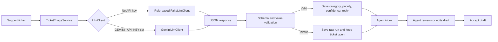

# Ticket Triage AI

Ticket Triage AI is a support inbox demo for **Harbor Desk**, a fictional support team. It turns incoming email, chat, and phone notes into a suggested category, priority, and customer reply. An agent reviews and edits every draft before accepting it.

The app is built with Laravel 13, Vue 3, Inertia, and Tailwind CSS. It uses a small provider interface so the product works locally without a model key and can optionally use Gemini.

## How the AI flow works



`App\Services\Triage\TicketTriageService` passes ticket context and a strict JSON schema through `App\Services\Llm\LlmClient`. The service validates the returned JSON and allowed category/priority values before writing predictions. Every attempt is stored in `triage_runs` with the raw response and model name. Provider errors and malformed output become a recoverable inbox state rather than an unhandled server error.

With no `GEMINI_API_KEY`, the app binds `FakeLlmClient`. Its deterministic rules make the full demo usable offline: invoice/charge → billing, tracking/package → shipping, crash/bug → product bug, and password/login → account. Chargebacks are urgent; hours questions are low priority. With a key configured, `GeminiLlmClient` requests schema-constrained JSON and enforces a 12-second HTTP timeout.

## Run locally without an API key

Requirements: PHP 8.3+, Composer, Node.js, and npm.

```bash
composer install
cp .env.example .env
php artisan key:generate
php -r "file_exists('database/database.sqlite') || touch('database/database.sqlite');"
php artisan migrate --seed
npm install
```

Leave `GEMINI_API_KEY` empty in `.env` to use the built-in rule-based provider. Start the application and Vite in separate terminals:

```bash
php artisan serve
npm run dev
```

Open <http://127.0.0.1:8000>. The demo uses SQLite by default and does not require an external helpdesk, account, model key, or queue service.

The seed creates 12 fictional Harbor Desk conversations across all five categories and all three channels. Three sample tickets are highlighted; the data includes an urgent billing chargeback and a low-priority support-hours question. No demo credentials are required because the inbox has no login.

To triage all open tickets that do not yet have a predicted category:

```bash
php artisan tickets:triage
```

## Optional Gemini provider

Set a Gemini API key in `.env` to switch the `LlmClient` binding from local rules to Gemini. Requests use `gemini-2.5-flash` by default and have a 12-second timeout.

```dotenv
GEMINI_API_KEY=your-key
GEMINI_MODEL=gemini-2.5-flash
```

The key is optional, must stay out of source control, and is never exposed to Vue.

## Tests

Run the backend test suite:

```bash
php artisan test
```

Feature tests bind `FakeLlmClient` so results are deterministic and never call an external API. They verify that an invoice/charge becomes high-priority billing, a crash becomes a product bug, the classify endpoint returns HTTP 200, malformed model JSON is recorded while the ticket stays open, the Artisan command only processes uncategorized open tickets, and an agent can accept an edited reply. The tests also assert that the no-key provider resolves to the fake implementation.

## Project map

- `app/Services/Llm/` — provider interface, offline fake, and optional Gemini adapter.
- `app/Services/Triage/` — schema-constrained request, validation, and run persistence.
- `app/Http/Controllers/TicketDeskController.php` — inbox page and classify/accept endpoints.
- `app/Models/SupportTicket.php`, `app/Models/TriageRun.php` — ticket and model-run records.
- `resources/js/pages/Welcome.vue` — responsive inbox and agent review workspace.
- `database/seeders/DatabaseSeeder.php` — fictional demo conversations.

## Scope

This is a portfolio demo, not a connected helpdesk. It contains no real client integrations, personal health information, payment processing, or Redis dependency. Suggested replies are drafts for a human agent to review.
